<div align="center">

# MealSync

**Good food. Less waiting.**
Order from the campus mess ahead of time, pick a 15-minute pickup slot and collect with one QR ticket — no billing queue, no crowd at the counter.

[](backend)
[](frontend)
[](docker-compose.yml)
[](docs/DOCKER.md)
[](k8s)
[](monitoring)

[**Showcase page**](https://meetgangwal.github.io/MealSync/) · [Quick start](#quick-start) · [Screens](#a-quick-tour) · [How it works](#how-it-works) · [Docs](#documentation)

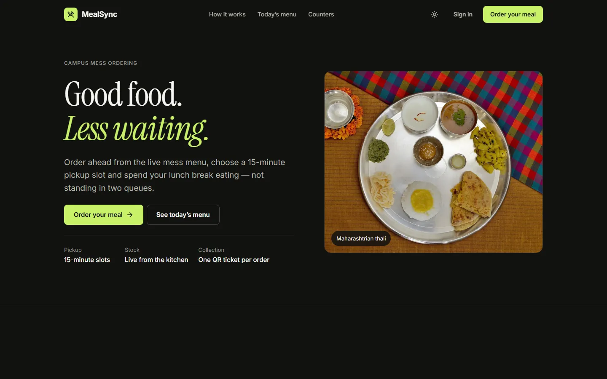

</div>

---

## Why MealSync

Our mess has **one billing counter**, **one thali counter** and **one counter for other dishes**. At lunch, students queue twice — once to pay, again to collect. MealSync removes the first queue and spreads the second one out:

- **Order ahead** from the real mess menu (80 dishes + thalis) with live stock and real photos.
- **Pick a pickup slot** — every 15-minute window has a fixed capacity, enforced by the server, so a counter is never swamped.
- **Pay when you order** (test payment simulator) or choose **cash at pickup**.
- **Show one QR ticket** at the right counter — MealSync tells you whether it is the thali counter or the other-dishes counter.
- **Mess staff** run an order queue (New → Preparing → Ready → Collected), ring up walk-in counter sales and manage the menu, stock and slots.
- **Administrators** see payment records, analytics, a demand forecast and live monitoring — computed by the backend, never mocked.

## A quick tour

| Student | Mess staff & admin |
|---|---|
| 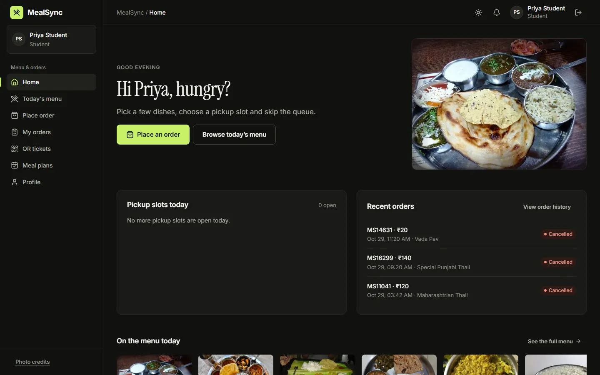 | 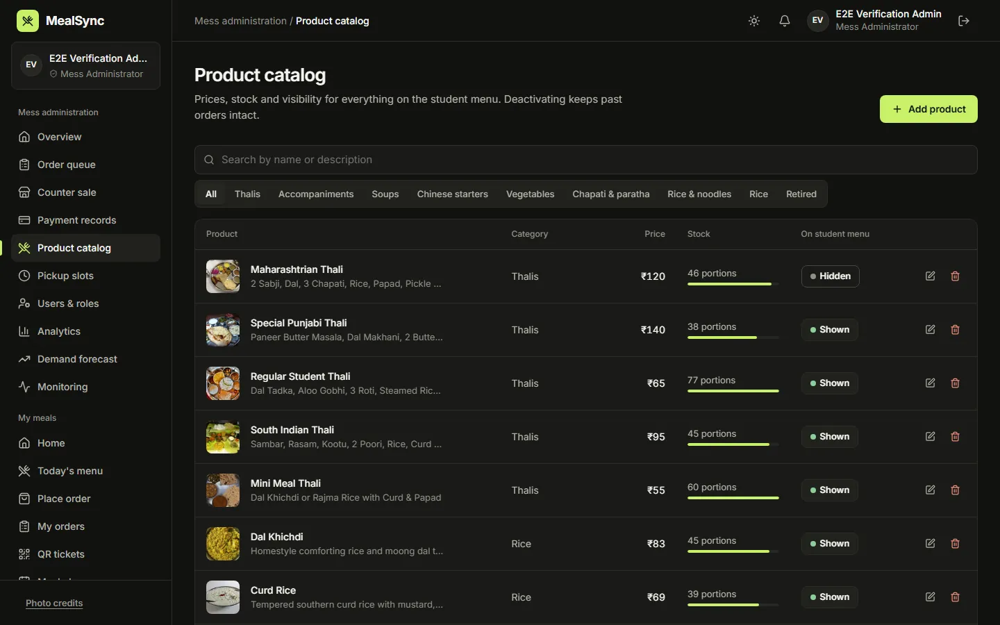 |
| **Home** — the next useful action first | **Product catalog** — prices, stock, show/hide, retire |
| 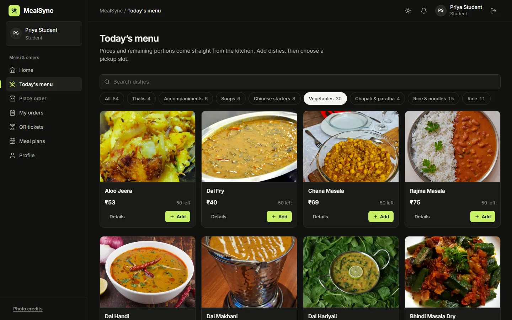 | 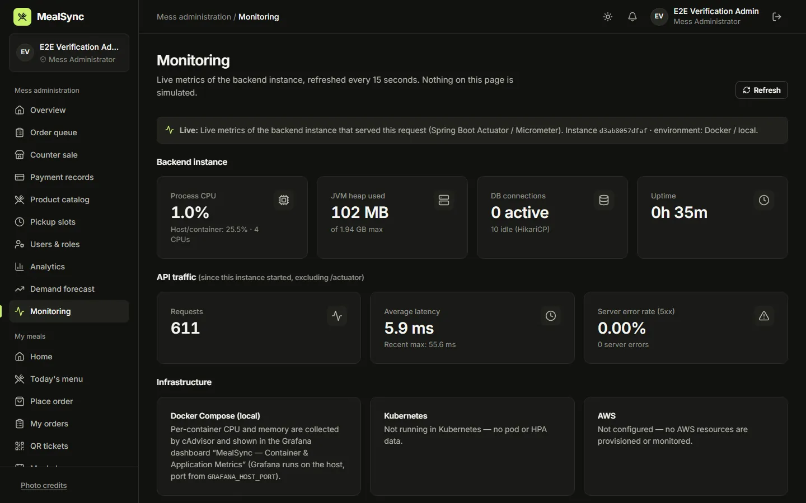 |
| **Today's menu** — the mess's printed card, by section | **Monitoring** — live Micrometer metrics, nothing simulated |
| 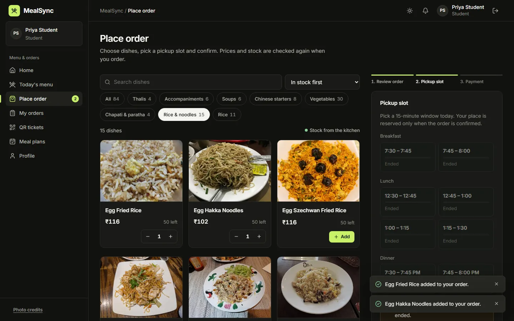 | 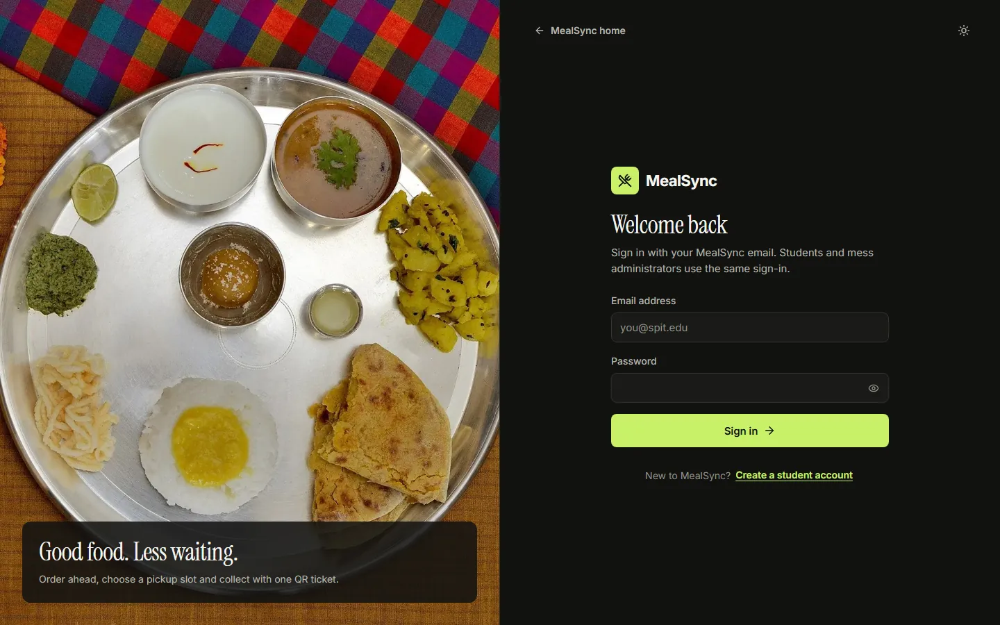 |
| **Checkout** — 3 steps, capacity-aware slots | **One sign-in** — the server decides the role |

<details>
<summary><b>More screens — light theme, mobile, landing menu</b></summary>
<br>

| Light theme | Mobile | Mobile landing |
|---|---|---|
| 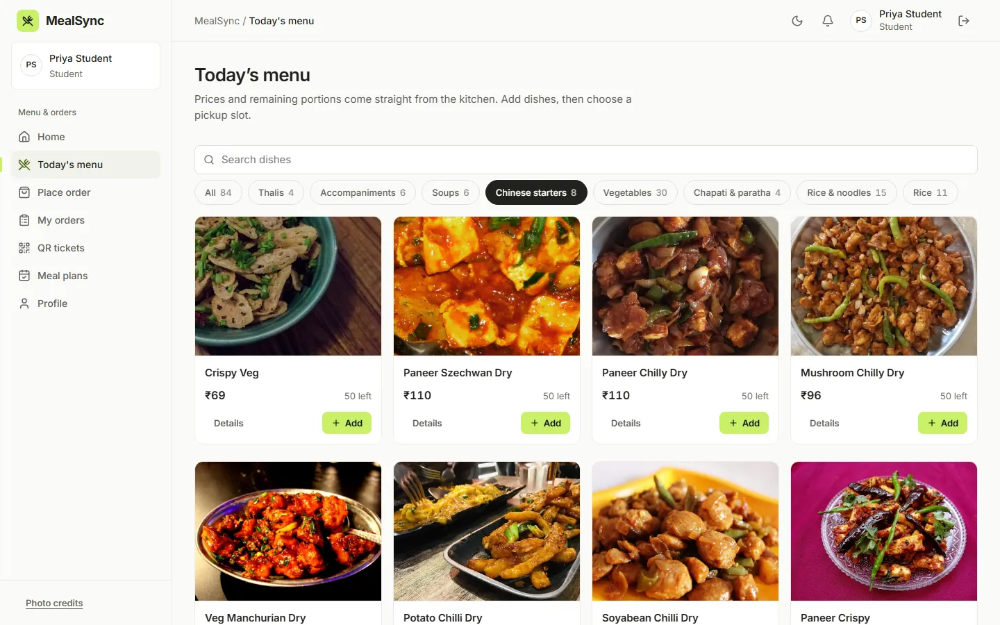 | 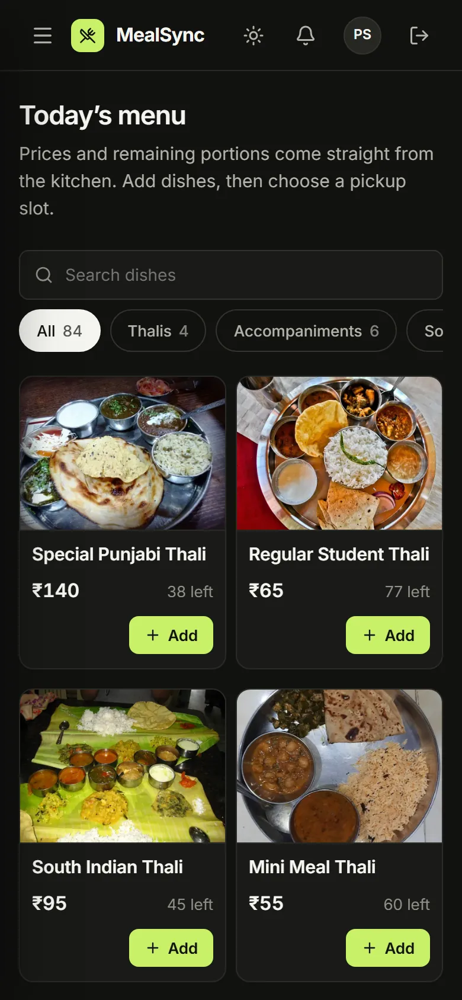 | 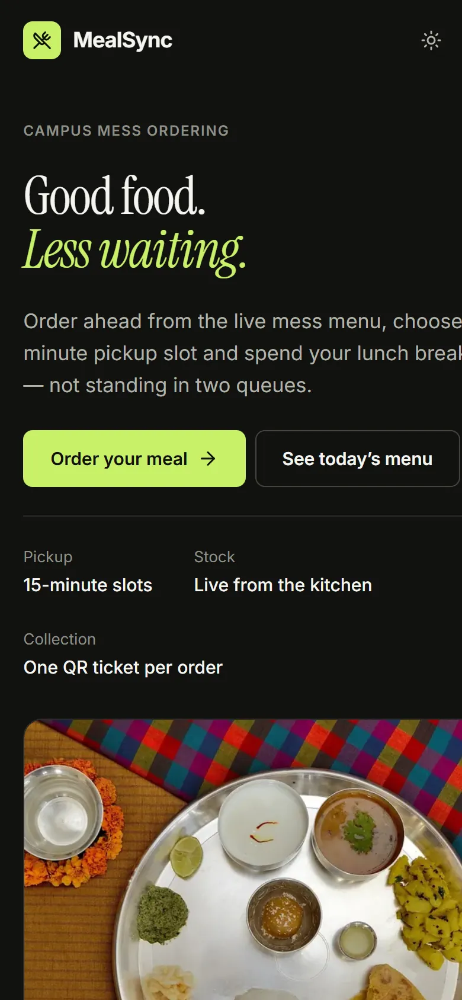 |

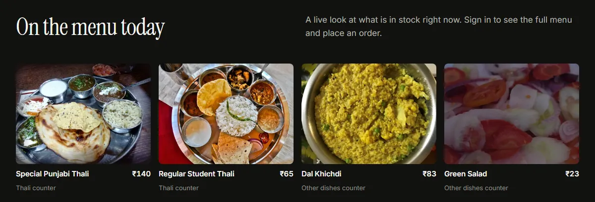

</details>

## How it works

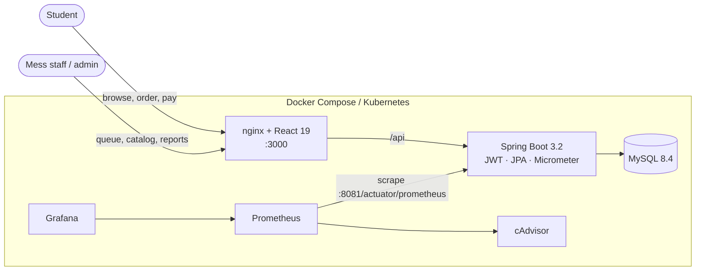

<details>
<summary><b>Ordering, step by step (sequence diagram)</b></summary>

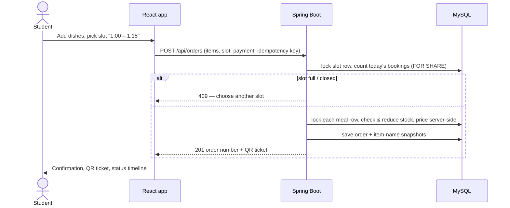

</details>

<details>
<summary><b>Order life cycle (state diagram)</b></summary>

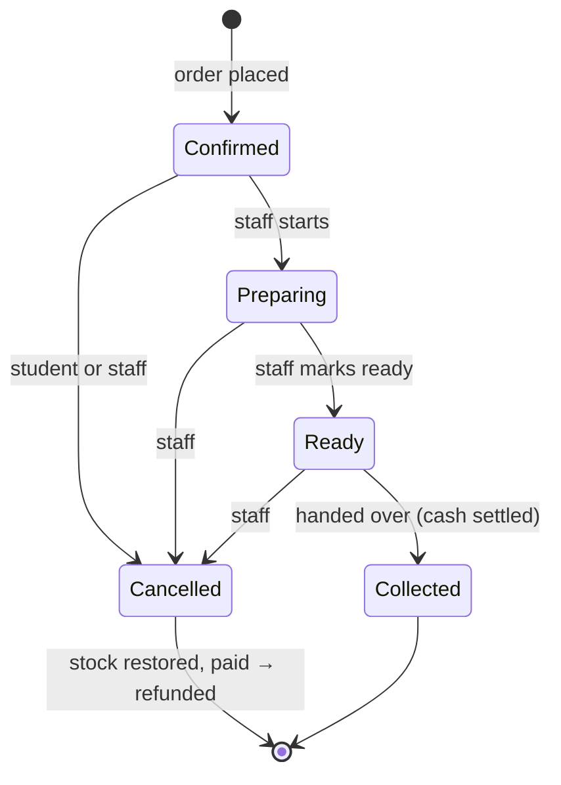

</details>

<details>
<summary><b>What the backend guarantees</b></summary>

- **Prices and totals** are computed on the server; the browser's cart is never trusted.
- **Stock** is reduced under row locks; a rejected multi-item order rolls back completely.
- **Slot capacity** is checked with a locking read, so two simultaneous orders cannot take the last place.
- **Duplicate submissions** are absorbed by an idempotency key.
- **Roles** are read from the database on every request; registration always creates a student.
- **Order history** keeps each item's name as it was ordered, even if the dish is renamed or retired.
- **Money** follows one set of definitions everywhere (collected, pending cash, refunded, cancelled) in India time — see [docs/ADMIN_AND_REPORTING.md](docs/ADMIN_AND_REPORTING.md).

</details>

## Quick start

Requires **Docker Desktop** (or Docker Engine + Compose v2).

```bash
git clone https://github.com/MeetGangwal/MealSync.git && cd MealSync
cp .env.example .env            # replace every CHANGE_ME value — never commit .env
bash scripts/run-local.sh       # builds, starts and waits until healthy, then prints the URLs
```

| Service | Default URL (change the `*_HOST_PORT` values in `.env`) |
|---|---|
| **App** (frontend, also proxies `/api`) | http://localhost:3000 |
| Backend API | http://localhost:8080/api/meals |
| Grafana | http://localhost:3001 |
| Prometheus | http://localhost:9090 |

Then create an account in the app. Every new account is a **student**; to make the first administrator, register normally and set `MEALSYNC_BOOTSTRAP_ADMIN_EMAIL` to that email in `.env` (details in [docs/ADMIN_AND_REPORTING.md](docs/ADMIN_AND_REPORTING.md)).

Stop with `docker compose stop` — data in the MySQL volume is kept.

<details>
<summary><b>Run without Docker (backend + Vite dev server)</b></summary>

Backend — needs MySQL 8.x with a `mealsync` database and user:

```bash
bash scripts/start-backend.sh     # loads ./.env (or backend/.env); http://localhost:8080
# or: cd backend && export DB_USERNAME=... DB_PASSWORD=... JWT_SECRET=... && ./mvnw spring-boot:run
```

Frontend:

```bash
cd frontend && npm install && npm run dev   # http://localhost:5173, /api proxied to :8080
```

Tables are created on first start; the menu, pickup slots and meal plans are seeded idempotently.

</details>

<details>
<summary><b>Environment variables</b></summary>

One `DB_*` convention is shared by the backend, Compose, Kubernetes and Ansible. Full list: [.env.example](.env.example).

| Variable | Purpose |
|---|---|
| `DB_HOST`, `DB_PORT`, `DB_NAME`, `DB_USERNAME`, `DB_PASSWORD` | Application database |
| `DB_ROOT_PASSWORD` | MySQL root password (container initialisation only) |
| `JWT_SECRET` | JWT signing key, at least 32 bytes (`openssl rand -hex 32`) |
| `JWT_EXPIRATION_MS` | Token lifetime (default 24 h) |
| `MEALSYNC_BOOTSTRAP_ADMIN_EMAIL` | Promotes this existing account to administrator on start-up |
| `MEALSYNC_TIME_ZONE` | Business day for reports (default `Asia/Kolkata`) |
| `GRAFANA_ADMIN_USER`, `GRAFANA_ADMIN_PASSWORD` | Grafana login |
| `MEALSYNC_SEED_DEMO_USERS` (+ passwords) | Opt-in demo accounts for local demos only |

</details>

## The menu

The other-dishes counter uses the mess's **printed card** (items 1–81): accompaniments, soups, Chinese starters, vegetables, chapati & paratha, rice & noodles and rice — see [`MessMenu.java`](backend/src/main/java/com/mealsync/config/MessMenu.java). Thalis are served at the thali counter. Mess staff set real stock, hide dishes or change prices in the **Product catalog**; earlier demo dishes are retired (kept only for order history).

Every dish has a photo. Photos are openly licensed from Wikimedia Commons (CC BY / CC BY-SA / CC0 / public domain) and credited in the app's **Photo credits** dialog; a few are labelled *representative* where no photo of the exact dish existed. Replace any of them with your own via the product's photo link.

## API

| Method | Path | Auth | Description |
|---|---|---|---|
| POST | `/api/auth/register` · `/api/auth/login` | Public | Register (always a student) · log in → JWT |
| GET / PUT | `/api/auth/me` · `/api/auth/profile` | JWT | Current user · update profile |
| GET | `/api/meals` | Public | Menu with stock and visibility |
| GET | `/api/slots` | JWT | Today's pickup slots with bookings |
| POST | `/api/orders` | Student JWT | Place an order (slot capacity + idempotency) |
| GET | `/api/orders/user/{id}` | Student JWT | Own orders |
| PUT | `/api/orders/{id}/cancel` | JWT | Cancel own order (admins: any) |
| GET / POST | `/api/subscriptions/**` | Student JWT | Meal plans: list, subscribe, pause, resume, skip today |
| * | `/api/admin/**` | Admin JWT | Products, order status, counter sales, slots, users & roles, payment records, analytics, forecast, monitoring |

Operational endpoints stay on the internal management port **8081**: `/actuator/health`, `/actuator/prometheus`.

## Testing

```bash
cd backend && ./mvnw clean verify              # unit + Testcontainers MySQL integration tests (Docker required)
cd frontend && npm ci && npm run lint && npm test && npm run build
bash scripts/smoke-test.sh http://localhost:3000   # end-to-end checks against a running stack
```

Latest local run: **116 backend tests**, **22 frontend tests**, **38/38 smoke checks** passing. Load testing with k6: [infra/load-testing](infra/load-testing/README.md).

## Documentation

| Topic | Where |
|---|---|
| UI/UX design system, screens and decisions | [docs/UI_REDESIGN.md](docs/UI_REDESIGN.md) |
| Admin bootstrap, financial definitions, test-data cleanup | [docs/ADMIN_AND_REPORTING.md](docs/ADMIN_AND_REPORTING.md) |
| Docker Compose stack | [docs/DOCKER.md](docs/DOCKER.md) |
| Kubernetes, Prometheus/Grafana, Terraform, Ansible | [k8s/README.md](k8s/README.md) · [docs/INFRASTRUCTURE.md](docs/INFRASTRUCTURE.md) |
| Security and reliability notes | [docs/SECURITY_AND_RELIABILITY.md](docs/SECURITY_AND_RELIABILITY.md) |
| What was verified, and how | [docs/VERIFICATION.md](docs/VERIFICATION.md) |

<details>
<summary><b>Common errors</b></summary>

| Error | Cause | Fix |
|---|---|---|
| `required variable ... is missing a value` | `.env` missing or incomplete | `cp .env.example .env` and fill it in |
| `JWT signing secret is too weak` | `JWT_SECRET` shorter than 32 bytes | `openssl rand -hex 32` |
| `Communications link failure` | MySQL not reachable | Check `DB_HOST`/`DB_PORT` and that MySQL is up |
| `Docker is not running` (run-local.sh) | Docker Desktop stopped | Start Docker Desktop |
| `409` when ordering | Slot full or closed | Choose another slot |
| `401` / `403` | Expired token / wrong role | Sign in again / ask an administrator |

</details>

<details>
<summary><b>Security notes</b></summary>

- Passwords hashed with BCrypt; JWT (HS256) secret comes from the environment and is never logged.
- Registration always assigns the student role; admin APIs require `ROLE_ADMIN`, checked server-side on every request.
- No credentials ship in the frontend; demo accounts exist only when explicitly enabled.
- The JWT is kept in browser storage (an XSS risk; HttpOnly cookies would be stronger).
- Online payments are a **test simulator** — no real money moves.
- Credentials committed in this repository's early history must be treated as compromised and rotated.

</details>

## Team

| | |
|---|---|
| **Meet Gangwal** | Application — React frontend, Spring Boot backend, security, API |
| **Aryan Dandekar** | Cloud & DevOps — Docker, Kubernetes, Prometheus/Grafana, Terraform, Ansible, CI/CD |

<sub>Food photographs: Wikimedia Commons contributors, used under the licences listed in the app's Photo credits dialog (`frontend/src/data/imageCredits.json`).</sub>
