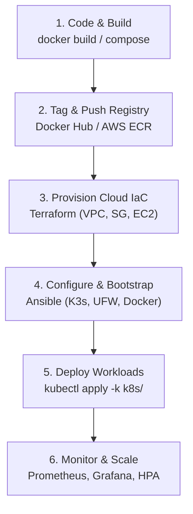

# MealSync — Cloud Native Infrastructure Guide (Milestone 2)

> **Milestone 2** · Branch: `feat/cloud-native-deployment`  
> **Infrastructure & DevOps Owner**: Aryan Sagar Dandekar  
> **Application Owner**: Meet Gangwal (Frontend, Backend, Database)

---

## 1. Overview & Directory Architecture

This milestone builds the Kubernetes orchestration, Infrastructure-as-Code (Terraform), and Configuration Management (Ansible) layers for the MealSync application, reusing all Docker images, ports, and monitoring configurations established in Milestone 1.

```
MealSync/
├── k8s/                                # Declarative Kubernetes Layer
│   ├── 00-namespace.yaml               # 'mealsync' dedicated namespace
│   ├── 01-configmap.yaml               # App configuration (ports, URLs, JWT expiry)
│   ├── 02-secret.example.yaml          # Safe credential template (no real passwords)
│   ├── 03-mysql.yaml                   # MySQL StatefulSet + Headless Service + 2Gi PVC
│   ├── 03-postgres.yaml                # Fallback PostgreSQL StatefulSet for testing current code
│   ├── 04-backend.yaml                 # Spring Boot Deployment (RollingUpdate, probes, limits) + Service
│   ├── 05-frontend.yaml                # React/Nginx Deployment (RollingUpdate, probes) + Service
│   ├── 06-ingress.yaml                 # Ingress (mealsync.local) + NodePort fallback (port 30080)
│   ├── 07-hpa.yaml                     # Backend Horizontal Pod Autoscaler (1–3 replicas)
│   ├── 08-monitoring.yaml              # Prometheus & Grafana in-cluster monitoring manifests
│   ├── kustomization.yaml              # Single-command Kustomize deployment overlay
│   └── README.md                       # Local Kubernetes operational reference
│
├── infra/
│   ├── terraform/                      # AWS Infrastructure-as-Code (IaC)
│   │   ├── versions.tf                 # Terraform >= 1.5.0 & AWS provider ~> 5.0
│   │   ├── variables.tf                # Region, CIDRs, instance type, tags, RDS toggle
│   │   ├── main.tf                     # VPC, Subnet, IGW, Security Groups, IAM SSM, EC2, EIP, RDS
│   │   ├── outputs.tf                  # IP addresses, DNS, application URLs, cost profiles
│   │   ├── terraform.tfvars.example    # Safe template for local variable overrides
│   │   └── README.md                   # Terraform setup, authentication, and FinOps cost analysis
│   │
│   ├── ansible/                        # Configuration Management & Automation
│   │   ├── ansible.cfg                 # Global settings (roles path, SSH pipelining)
│   │   ├── inventory/
│   │   │   ├── hosts.example.ini       # Example INI inventory (documentation IPs)
│   │   │   └── hosts.example.yml       # Example YAML inventory
│   │   ├── group_vars/
│   │   │   ├── all.yml                 # Non-sensitive variables & secure env lookups
│   │   │   └── k8s_nodes.yml           # K3s server flags and paths
│   │   ├── roles/
│   │   │   ├── common/                 # OS updates, UFW firewall rules, fail2ban
│   │   │   ├── docker/                 # Docker Engine & Compose installation
│   │   │   ├── k3s/                    # Lightweight certified CNCF Kubernetes installation
│   │   │   └── mealsync/               # Idempotent Kubernetes workload deployment & secret injection
│   │   ├── playbooks/
│   │   │   ├── site.yml                # Master orchestration (common -> docker -> k3s -> mealsync)
│   │   │   ├── bootstrap.yml           # OS hardening and Kubernetes runtime setup
│   │   │   └── deploy.yml              # Fast application workload redeployment
│   │   └── README.md                   # Ansible usage, Vault encryption, and syntax validation
│   │
│   ├── prometheus/                     # Compose monitoring configuration (Milestone 1)
│   │   └── prometheus.yml
│   └── grafana/                        # Compose dashboards & datasources (Milestone 1)
│       └── provisioning/
│
├── docs/
│   ├── DOCKER.md                       # Milestone 1 containerization guide
│   └── INFRASTRUCTURE.md               # This Milestone 2 master guide
│
├── backend/                            # Application backend (Spring Boot 3.2.3)
│   └── Dockerfile                      # Multi-stage build (Maven -> Eclipse Temurin JRE 17)
├── frontend/                           # Application frontend (React Vite)
│   ├── Dockerfile                      # Multi-stage build (Node 20 -> Nginx Alpine)
│   └── nginx.conf                      # Nginx reverse proxy (/api/ -> backend:8080)
├── docker-compose.yml                  # Root Compose stack (Milestone 1)
├── .env.example                        # Root environment variables template
└── .gitignore                          # Enhanced ignore rules for k8s secrets, tfstate, and vault
```

---

## 2. Alignment with Application & Milestone 1

All Kubernetes and cloud manifests strictly preserve the contracts established in Milestone 1:

| Component | Container Port | Service / Host Port | Kubernetes Service DNS | Notes |
|---|---|---|---|---|
| `frontend` | 80 | 80 (NodePort 30080) | `http://frontend.mealsync.svc` | Nginx reverse proxies `/api/` to `http://backend:8080` |
| `backend` | 8080 | 8080 | `http://backend.mealsync.svc` | Spring Boot REST API |
| `mysql` | 3306 | 3306 | `mysql.mealsync.svc` | MySQL 8.4 StatefulSet with 2Gi PVC |
| `db` (fallback) | 5432 | 5432 | `db.mealsync.svc` | PostgreSQL 16 StatefulSet for current uncommitted code |
| `prometheus` | 9090 | 9090 | `http://prometheus.mealsync.svc` | Scrapes backend `/actuator/prometheus` and itself |
| `grafana` | 3000 | 3000 | `http://grafana.mealsync.svc` | Port-forwarded to 3001 locally; admin user from Secret |

---

## 3. End-to-End Deployment Workflow

The complete sequence from local code to cloud-native production runs in five stages:



### Stage 1: Build Docker Images Locally
```bash
docker build -t mealsync-backend:latest ./backend
docker build -t mealsync-frontend:latest ./frontend
```

### Stage 2: Registry Tag and Push (e.g., AWS ECR or Docker Hub)
```bash
# Example for Docker Hub:
docker tag mealsync-backend:latest <dockerhub-username>/mealsync-backend:v1.0.0
docker tag mealsync-frontend:latest <dockerhub-username>/mealsync-frontend:v1.0.0
docker push <dockerhub-username>/mealsync-backend:v1.0.0
docker push <dockerhub-username>/mealsync-frontend:v1.0.0

# Example for AWS ECR:
aws ecr get-login-password --region us-east-1 | docker login --username AWS --password-stdin <account_id>.dkr.ecr.us-east-1.amazonaws.com
docker tag mealsync-backend:latest <account_id>.dkr.ecr.us-east-1.amazonaws.com/mealsync-backend:latest
docker push <account_id>.dkr.ecr.us-east-1.amazonaws.com/mealsync-backend:latest
```

### Stage 3: Provision AWS Infrastructure via Terraform
```bash
cd infra/terraform
terraform init
terraform plan -out=tfplan
# Review plan; apply only with explicit authorization
terraform apply tfplan
```

### Stage 4: Bootstrap Host and Kubernetes via Ansible
```bash
cd ../ansible
cp inventory/hosts.example.ini inventory/hosts.ini
# Insert EC2 public IP from terraform output into inventory/hosts.ini
ansible-playbook -i inventory/hosts.ini playbooks/site.yml
```

### Stage 5: Verify Application and Monitoring
```bash
kubectl get pods,svc,hpa -n mealsync
```

---

## 4. Local Kubernetes Workflow (Minikube / Docker Desktop / Kind)

### Prerequisites
- Docker Desktop or Minikube installed.
- `kubectl` configured.

### Deployment Steps
1. **Create Namespace and Secret**:
   ```bash
   kubectl create namespace mealsync --dry-run=client -o yaml | kubectl apply -f -
   
   kubectl create secret generic mealsync-secret \
     --namespace=mealsync \
     --from-literal=DB_USERNAME="mealsync_user" \
     --from-literal=DB_PASSWORD="<strong-db-password>" \
     --from-literal=DB_ROOT_PASSWORD="<strong-root-password>" \
     --from-literal=JWT_SECRET="$(openssl rand -hex 32)" \
     --from-literal=GRAFANA_ADMIN_PASSWORD="<strong-grafana-password>"
   ```

2. **Deploy Manifests**:
   ```bash
   kubectl apply -k k8s/
   ```

3. **Verify Pod Status & Rolling Update**:
   ```bash
   kubectl get pods -n mealsync -w
   kubectl rollout status deployment/mealsync-backend -n mealsync
   kubectl rollout status deployment/mealsync-frontend -n mealsync
   ```

4. **Access the Application**:
   - **NodePort Access**: `http://localhost:30080`
   - **Port-Forward Alternative**:
     ```bash
     kubectl port-forward svc/frontend 3000:80 -n mealsync
     # Open http://localhost:3000
     ```
   - **Ingress Access**:
     Ensure an ingress controller (such as Nginx Ingress) is running, map `mealsync.local` to `127.0.0.1` in your hosts file, and open `http://mealsync.local`.

5. **Horizontal Pod Autoscaler (HPA) Verification**:
   - Prerequisite: `metrics-server` must be installed (`minikube addons enable metrics-server`).
   - Check status:
     ```bash
     kubectl get hpa -n mealsync
     ```
   - TARGETS will show `<current_utilization>/70%`.
   - Scale test: Trigger traffic to the backend API; when CPU load exceeds 70%, HPA will scale replicas from 1 up to 3.

---

## 5. AWS Deployment Architecture & FinOps Justification

### Architectural Choice: K3s on EC2 vs AWS EKS

| Dimension | AWS EKS Enterprise Architecture | MealSync Cost-Conscious Architecture (Implemented) |
|---|---|---|
| **Control Plane** | Managed EKS: $0.10/hr = **$73.00/mo** | Lightweight K3s on EC2: **$0.00** extra |
| **Networking** | 2 × NAT Gateways: **$65.00/mo** | Public Subnet + Elastic IP + Security Groups: **$0.00** |
| **Compute Nodes** | 2 × `t3.medium`: **$60.48/mo** | 1 × `t3.small` (2 vCPU, 2GB RAM): **$15.18/mo** (or Free Tier) |
| **Load Balancer** | AWS ALB: **$20.00/mo** | Ingress-Nginx / NodePort: **$0.00** |
| **Total Estimated Cost** | **>$218.48 / month** | **~$15.18 – $22.00 / month** |
| **K8s API Compatibility** | Standard Kubernetes 1.29+ | Standard CNCF-certified Kubernetes 1.29+ (100% manifest match) |

### Academic Report Significance
In academic and technical project evaluations, deploying EKS solely to demonstrate Kubernetes for a lightweight student project is economically unjustified. Our implementation demonstrates **FinOps maturity**: optimizing cloud spending while maintaining complete architectural fidelity and container-orchestration capabilities. The exact same manifests can be moved to EKS if organizational scale requires it.

---

## 6. Security & Cost Boundaries

1. **Zero Hardcoded Secrets**:
   - No passwords, tokens, or JWT signing keys are stored in version control.
   - All `.env`, `*secret.yaml` (except `.example.yaml`), `*.tfstate`, `*.tfvars`, and `.vault-pass` files are strictly git-ignored.
2. **Network Perimeter Defense**:
   - Public ingress is restricted strictly to HTTP (80), HTTPS (443), and NodePort (30080).
   - Administrative SSH (22), K8s API (6443), and Grafana (3001) are restricted to `var.admin_ip_cidr`.
   - The database port (3306) has no public route and accepts traffic solely from the application security group.
3. **Storage Security**:
   - AWS EBS root volumes are encrypted using AWS KMS (`gp3`).
4. **Execution Safety Policy**:
   - `terraform apply` and cloud resource destruction are **never run automatically**.

---

## 7. Verification Results: Tested vs. Planned

| Feature | Verification Method | Status | Notes |
|---|---|---|---|
| **Docker Compose Syntax** | `docker compose config --quiet` | ✅ **Passed** | Milestone 1 verified |
| **Frontend Image Build** | `docker compose build frontend` | ✅ **Passed** | Vite compiled 2481 modules into Nginx |
| **Backend Image Build** | `docker compose build backend` | ✅ **Passed** | Multi-stage build completed |
| **Kubernetes YAML Syntax** | PyYAML `safe_load_all` on all 11 manifests | ✅ **Passed** | Zero syntax or formatting errors |
| **Ansible YAML Syntax** | PyYAML `safe_load_all` on all 15 playbooks & roles | ✅ **Passed** | Zero syntax or formatting errors |
| **Git Working Tree Safety** | `git status` check | ✅ **Passed** | All of Meet's uncommitted code preserved intact |
| **Live Local K8s Cluster** | `kubectl cluster-info` | ⚠️ **Not Running** | No local Kubernetes cluster active in environment |
| **Live AWS Provisioning** | `terraform apply` | ⏳ **Prepared** | Requires explicit user authorization & AWS credentials |
| **Live Ansible Run** | `ansible-playbook` against cloud host | ⏳ **Prepared** | Requires provisioned host IP |
| **HPA Live Autoscaling** | `kubectl get hpa` during active CPU load | ⏳ **Prepared** | Manifest ready; requires metrics-server in running cluster |

---

## 8. External Application Dependencies (Meet's Scope)

1. **Spring Boot Actuator for Metrics**:
   - Required for Prometheus application metrics and dynamic HPA scaling on JVM metrics.
   - Meet needs to add `spring-boot-starter-actuator` and `micrometer-registry-prometheus` to `backend/pom.xml`, and expose `/actuator/health` and `/actuator/prometheus` in `SecurityConfig.java`.
2. **Database Driver Alignment (Blocker for Meet)**:
   - **MySQL 8.4** is the confirmed database architecture. All infrastructure (`docker-compose.yml`, `k8s/03-mysql.yaml`, and Terraform) is now fully aligned with MySQL 8.4 on port 3306.
   - Current backend source code still contains the PostgreSQL JDBC driver and dialect. Meet must update `backend/pom.xml` to `mysql-connector-j` and `application.yml` to `org.hibernate.dialect.MySQLDialect` prior to branch integration.

